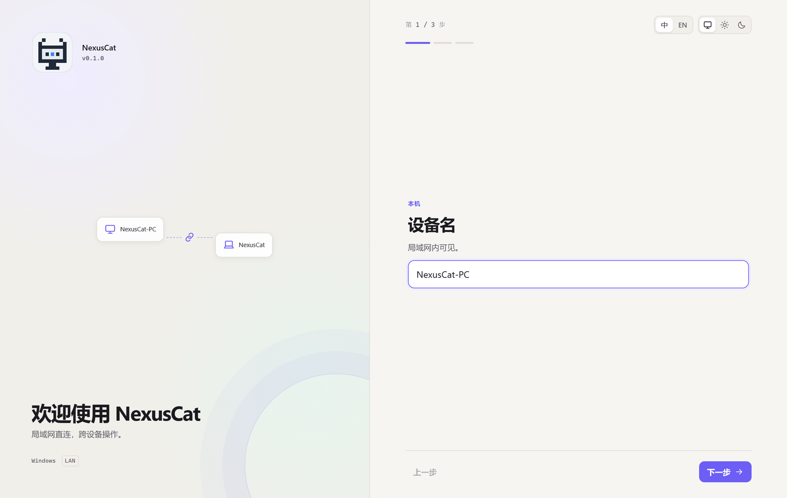
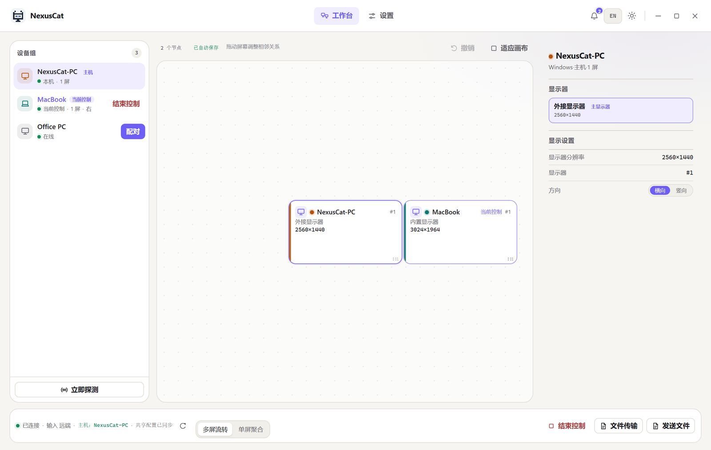
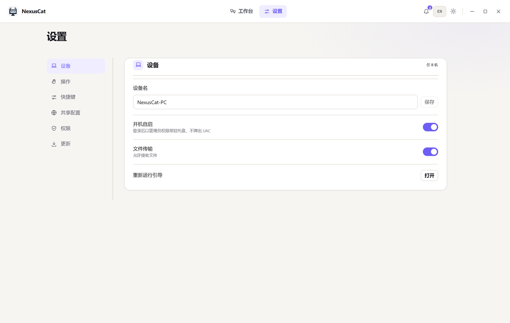
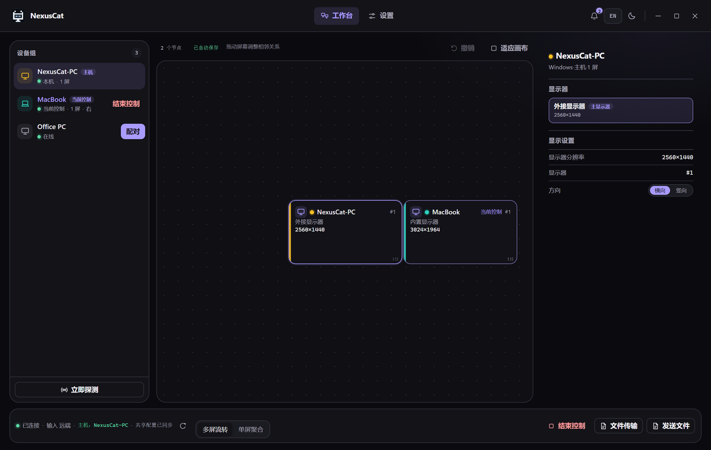
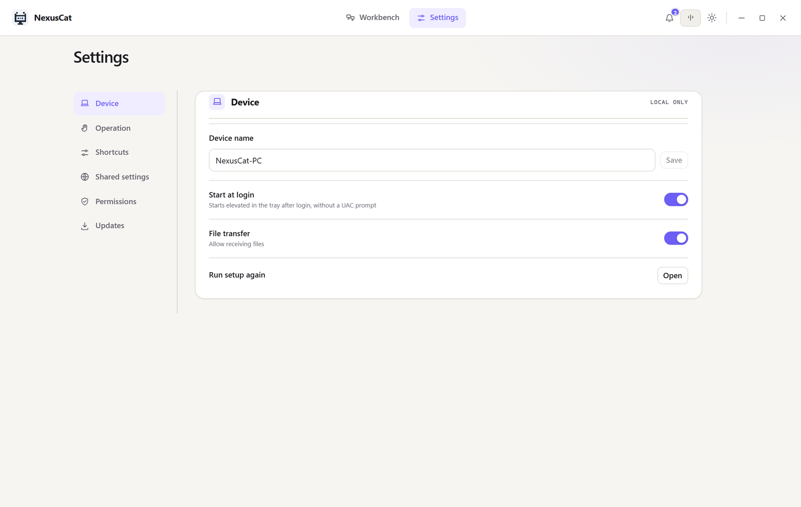
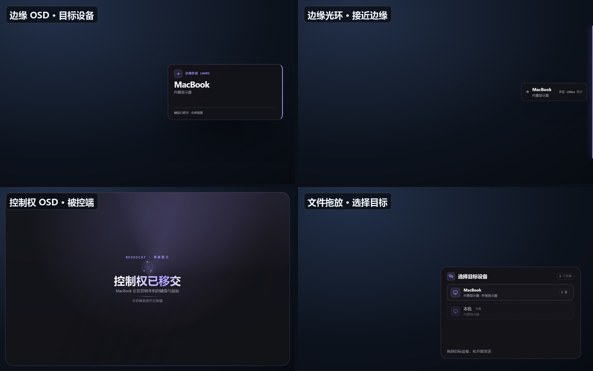
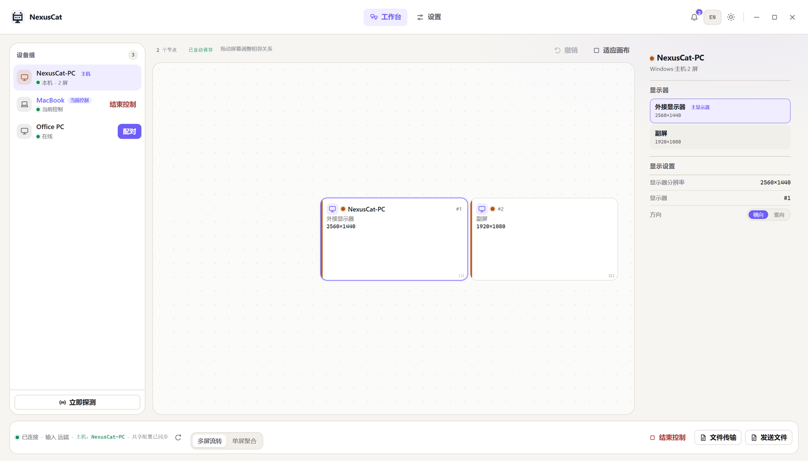

  

<h1 align="center">NexusCat</h1>

Windows ↔ macOS 局域网跨设备操作

NexusCat 把同一局域网内的 Windows 与 macOS 设备组成一个设备组，让一套键盘鼠标在多台电脑之间流转；也可以把另一台设备当作远程桌面，全屏显示并直接操作。

> 安装包由 GitHub Actions 自动构建。请到仓库的 **Releases** 页面下载最新版本；本 README 只介绍安装与使用。

## 界面预览

### 首次启动

> 设置设备名、选择工作模式，并按提示完成权限检查。

### 设备组与布局

> 把屏幕拖成与实际桌面一致的相邻关系；鼠标越过边缘即可切换到对应设备。截图中的设备名和分辨率均为演示数据。

### 设置

> 设备名、开机自启、文件传输、快捷键、共享配置、权限与更新都集中在这里。

### 深色主题与英文界面

> 深色主题下，工作台、布局画布与设备卡片使用同一套配色。

> 英文界面：导航、设置分组、按钮与说明全部切换；设备名与显示器名保留系统原名。

### 边缘提示与 OSD

> 左上：边缘 OSD，显示目标设备与移交结果；右上：边缘光环，接近可切换边缘时出现；左下：控制权 OSD，被控端提示控制权归属；右下：文件拖放浮层，按设备选择目标。

### 单设备多屏

> 同一台设备的多块屏幕会分别显示在布局画布中；右侧可以分别查看每块显示器。鼠标在同一设备的多块屏幕之间移动时，只切换显示节点，不切换输入所有者。

## 核心功能

- **设备组**：配对的设备保持直连。任意在线已配对设备都能用本机键鼠成为主机，不需要提前“设为主机”。
- **多屏流转（软 KVM）**：把另一台设备当作相邻显示器。鼠标越过屏幕边缘并停留约 100 ms 后，键盘、鼠标、焦点、剪贴板与文件发送交给目标设备，本机不显示远端画面。
- **单屏聚合（远程桌面全屏）**：本机全屏显示远端桌面，键盘鼠标直接操作远端；支持系统音频回传与自适应码率。
- **后台常驻**：关闭控制面板不会退出；应用继续在托盘/菜单栏运行，支持开机自启。
- **文件与剪贴板**：拖动文件到目标设备浮层即可发送；剪贴板文本与图片可同步。
- **中英双语与明暗主题**：界面可随时切换。
- **局域网更新**：从设置页把更新包推送到已配对设备，支持回退。

## 系统要求

| 项目 | 要求 |
| --- | --- |
| Windows | Windows 10 22H2+ / Windows 11 x64；需要 WebView2 Runtime |
| macOS | macOS 13+；Apple Silicon 为主要目标，Intel Mac 最佳努力 |
| 网络 | 两台或多台设备位于同一局域网；建议有线或稳定的 Wi-Fi |
| 版本 | 所有设备必须运行同一个 NexusCat 发布版本 |
| 权限 | Windows 需要管理员权限；macOS 需要屏幕录制、辅助功能、输入监控与本地网络权限 |

## 下载与安装

### Windows

在 Releases 页面下载任一文件：

- **安装版**：`NexusCat_<版本>_x64-setup.exe`
- **便携版**：`NexusCat-<版本>-windows-x64-portable.zip`

安装版按向导完成安装。便携版解压后双击 `nexuscat.exe` 即可运行，不需要安装。

首次运行：

1. 接受管理员授权提示；NexusCat 需要提升权限来处理系统级输入与拖放代理。
2. 允许应用访问“专用网络”，否则局域网发现和媒体传输可能失败。
3. 如果双击没有反应，先检查 WebView2 Runtime 是否已安装，再查看 `%LOCALAPPDATA%\NexusCat\startup.log`。

> 安装包未做代码签名，Windows SmartScreen 可能提示“未知发布者”。确认文件来自本仓库 Releases 后再选择“更多信息 → 仍要运行”。

### macOS

在 Releases 页面下载：

- **安装镜像**：`NexusCat_<版本>_aarch64.dmg`
- **应用压缩包**：`NexusCat-<版本>-macos-arm64.zip`（解压后把 `NexusCat.app` 拖入“应用程序”）
- **自动更新包**：`NexusCat-<版本>-macos-arm64.pkg`（用于局域网推送更新，普通安装不需要）

1. 打开 `.dmg`，把 `NexusCat.app` 拖入“应用程序”。
2. 首次打开时按提示授予屏幕录制、辅助功能与输入监控权限。
3. 在“系统设置 → 隐私与安全性 → 本地网络”中允许 NexusCat 访问本地网络。
4. 授权后完全退出并重新打开应用。

> macOS 应用未签名与公证，Gatekeeper 可能阻止首次打开。可在“系统设置 → 隐私与安全性”中选择“仍要打开”，或右键应用选择“打开”。

## 快速上手

以两台设备 A、B 为例：

1. **安装并启动**：两台设备安装同一版本并启动 NexusCat，完成首次引导。
2. **连接同一网络**：确认两台设备在同一网段，且没有开启访客网络隔离。
3. **配对**：
   - 在 A 的设备列表中点击 B 右侧的“配对”。
   - 两端会显示相同的 6 位数字（SAS）。
   - 核对一致后，在两端确认。
4. **排列屏幕**：
   - 进入“工作台”，把设备卡片上的屏幕拖成与实际桌面一致的相对位置。
   - 鼠标从本机屏幕边缘移向相邻设备的方向，停留片刻即可切换。
5. **开始使用**：
   - 在多屏流转模式下，输入会跟随鼠标越过屏幕边缘。
   - 在单屏聚合模式下，按 `Ctrl+Alt+F` 或点击“单屏聚合”进入远端全屏。

> 设备名、屏幕方向与布局都保存在本机。重新配对不会自动覆盖已有布局。

## 两种工作模式

### 多屏流转（软 KVM）

适合“把另一台电脑当作旁边的显示器”：

- 每台设备显示自己的桌面，本机不显示远端画面。
- 鼠标越过屏幕边缘并停留约 100 ms 后，键盘、鼠标、焦点、剪贴板与文件发送交给目标设备。
- 输入已经在远端时，可以继续向四个方向的相邻设备切换，按原路返回。
- 把鼠标移回本机方向、双击 `Esc`，或在控制面板中点击“结束控制”，即可收回输入。

### 单屏聚合（远程桌面全屏）

适合“把另一台电脑当作远程桌面”：

- 在控制面板、托盘菜单或全局快捷键 `Ctrl+Alt+F` 打开全屏视图。
- 全屏视图开启后，键盘鼠标交给远端，并显示远端画面与系统音频。
- 鼠标移向其他设备方向或使用面板切换目标，可继续切换远端设备。
- 双击 `Esc`、把鼠标推回本机方向边缘、打开控制面板或切换回多屏流转，即可退出全屏并释放输入。

> 单屏聚合只在全屏视图开启时接管输入；全屏未开启时输入仍在本机。

## 常用操作

### 默认快捷键

| 操作 | 默认快捷键 |
| --- | --- |
| 切换多屏流转 / 单屏聚合 | `Ctrl+Alt+M` |
| 打开或关闭全屏视图 | `Ctrl+Alt+F` |
| 打开布局校准 | `Ctrl+Alt+C` |
| 暂停远端控制 | `Ctrl+Alt+Space` |
| 开启或关闭边缘接管 | `Ctrl+Alt+E` |

快捷键可以在“设置 → 快捷键”中修改；如果与系统或其他应用冲突，界面会给出提示。

### 托盘 / 菜单栏

关闭控制面板不会退出应用。NexusCat 会继续在托盘（Windows）或菜单栏（macOS）运行；从托盘菜单选择“退出”才会完全退出。

### 文件传输

- 在桌面或文件管理器中开始拖动文件时，光标所在屏幕右下角会出现设备浮层。
- 把文件拖到目标设备卡片，即可发送到该设备。
- 也可以在控制面板点击“发送文件”，选择文件后发送给当前连接设备。
- 接收到的文件保存在系统“下载”目录下的 `NexusCat` 文件夹。

### 剪贴板与系统音频

- 剪贴板同步支持文本与 PNG 图片，可在设置中关闭。
- 单屏聚合可以把被控端的系统音频回传；可在设置中关闭。

### 开机自启

在“设置 → 设备”中开启“开机自启”。Windows 会使用登录计划任务以最高权限启动，登录时不会再次弹出 UAC；macOS 使用系统登录项。

### 更新

- 在“设置 → 更新”选择更新包，推送到已配对设备。
- 对端可以在线接收、校验并安装；也可以手动回退到上一版本。
- 更新包通过局域网传输，不上传公网。

## 权限说明

### Windows

- 启动时需要管理员权限；这是系统级输入注入、安全桌面与拖放代理的要求。
- 首次运行请允许“专用网络”访问。
- 可以在设置页安装可选的“系统输入服务”，用于在 UAC/锁屏安全桌面上继续接收输入。
- 如果控制端口被占用，应用会自动改用系统分配端口，并在日志中记录实际端口。

### macOS

需要在“系统设置 → 隐私与安全性”中授予：

- **屏幕录制**：采集远端画面。
- **辅助功能**：注入键盘与鼠标事件。
- **输入监控**：捕获本机输入。
- **本地网络**：发现与连接局域网设备。

授予权限后建议完全退出并重新打开应用。macOS 13–15 的高刷新呈现依赖 WebKit 私有开关，仅适用于直接安装分发的版本。

## 常见问题

**两台设备互相看不到**

1. 确认在同一局域网、同一网段，且没有开启访客网络隔离或客户端隔离。
2. 确认两端运行同一个 NexusCat 版本。
3. 在 Windows 防火墙中允许 NexusCat 通过“专用网络”；macOS 允许本地网络。
4. 如果使用了 VPN 或虚拟网卡，尝试暂时断开后重新探测。

**配对后无法连接**

- 检查两端控制端口是否被防火墙拦截。
- 在设备列表中点击“立即探测”刷新状态。
- 删除信任后重新配对，确认两端显示相同的 6 位 SAS。

**Windows 提示未知发布者**

安装包未做代码签名，SmartScreen 会提示。确认文件来自本仓库 Releases，再选择“更多信息 → 仍要运行”。

**macOS 提示无法打开或已损坏**

这是 Gatekeeper 对未签名应用的提示。在“系统设置 → 隐私与安全性”中选择“仍要打开”，或右键应用选择“打开”。不要使用来源不明的第三方“修复”工具。

**关闭窗口后应用还在运行**

这是设计行为。NexusCat 需要后台常驻以保持连接与边缘接管；请从托盘/菜单栏菜单选择“退出”。

**Windows 双击没有反应**

1. 检查 WebView2 Runtime。
2. 查看 `%LOCALAPPDATA%\NexusCat\startup.log`。
3. 确认接受了管理员授权提示。
4. 确认用户目录可写；应用会回退到 `%LOCALAPPDATA%\NexusCat` 或临时目录。

**发送文件失败**

- 确认接收端已连接且文件传输开关已开启。
- 检查接收端下载目录是否可写。
- 大文件传输期间保持两端在线。

**更新失败**

- 确认两端版本与更新包匹配。
- 更新包只通过局域网传输；确认网络稳定。
- macOS 自动更新只支持 `.pkg`；`.dmg`/`.app` 便携替换不支持。

## 已知限制

- 只支持局域网，不提供公网、P2P 打洞或中继。
- 所有设备必须运行同一发布版本；旧构建无法完成握手。
- 安装包与 macOS 应用未签名；首次运行可能被 SmartScreen/Gatekeeper 拦截。
- 不支持触控与笔输入，仅支持键盘鼠标。
- 1080p120、4K60 与低延迟指标属于实验性能力，实际表现取决于采集、编码、网络与解码后端。
- macOS 的屏幕采集、系统音频、输入注入与高刷新能力需要实机权限与硬件验证；部分能力仍属最佳努力。
- 安全桌面/UAC 输入需要可选的系统输入服务；未安装时应用会暂停远端输入并交回本机。
- 跨设备拖放、托盘菜单、开机自启与更新安装等系统集成能力需要在目标机器上实际验收。

## 安全与隐私

- 仅在同一局域网内发现与连接，不使用云端账号或遥测。
- 配对时双端核对相同的 6 位 SAS，确认后才建立信任。
- 控制平面使用 TLS 1.3；应用层使用 X25519 密钥交换与 ChaCha20-Poly1305。
- 设备身份、证书、信任列表与布局保存在本机数据目录。
- 更新包在局域网内传输并校验 SHA-256；当前版本不做签名验签，请只向信任的设备推送更新。
- 建议只与自己的设备配对，并在公共或不可信网络中关闭应用。

## 反馈

提交 Issue 时请附上：

- NexusCat 版本与操作系统版本
- 问题发生前的操作步骤
- 相关日志（Windows 启动日志位置见上文；macOS 日志在应用数据目录的 `logs/` 下）
- 是否使用了 VPN、虚拟网卡、多显示器或远程桌面

## 许可证

本项目使用 [Apache-2.0](LICENSE)。第三方依赖遵循各自的许可证。
